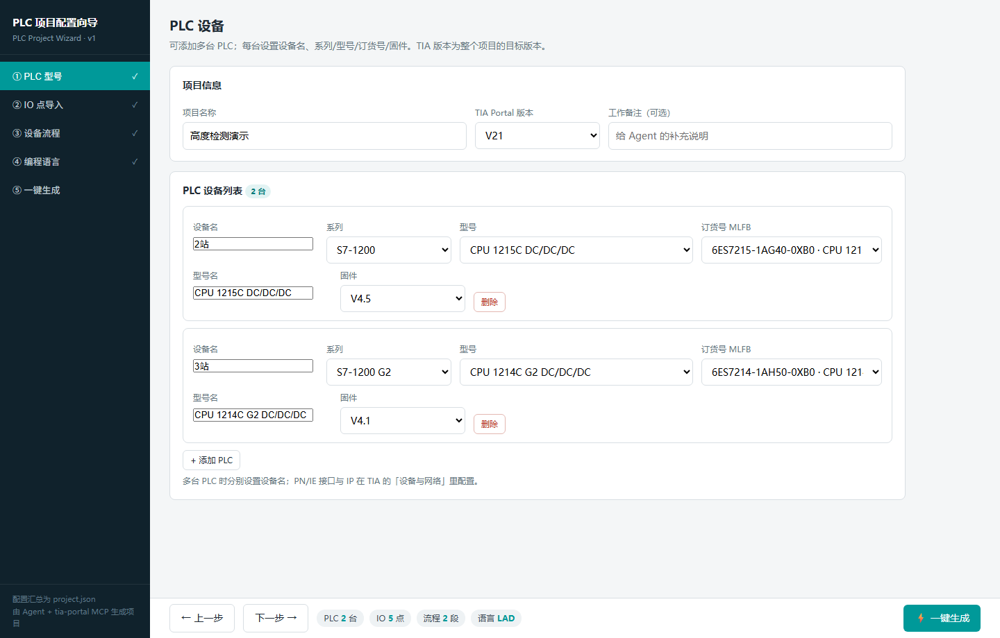
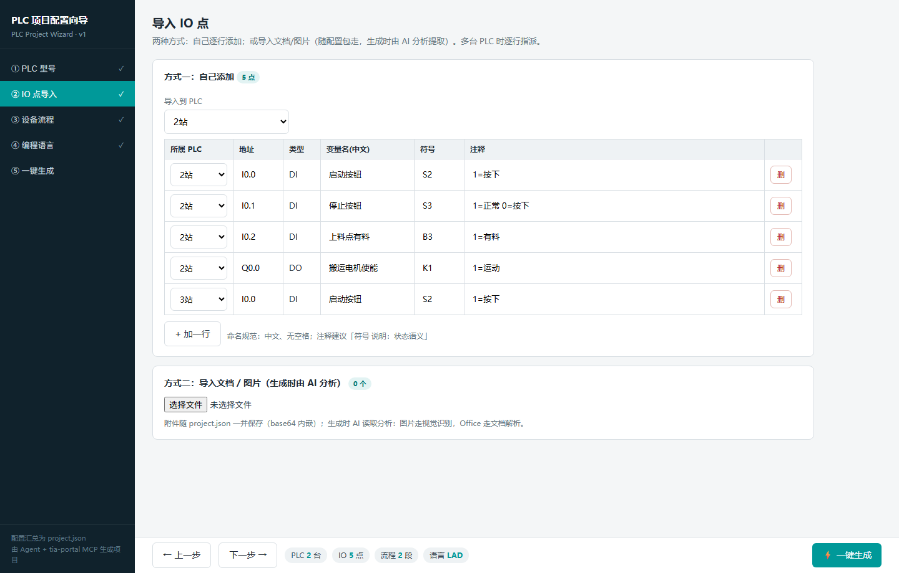
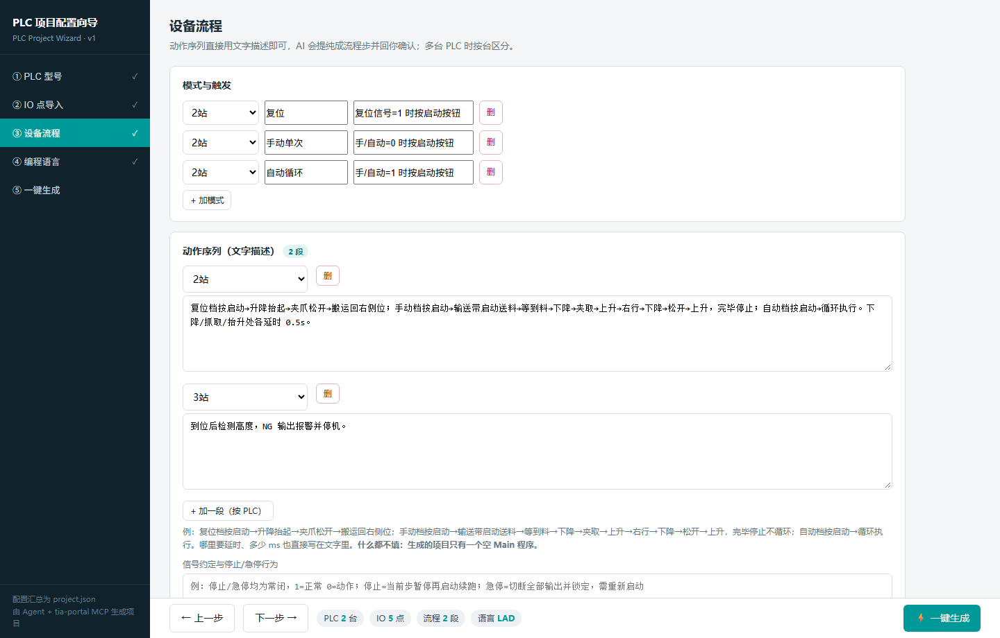
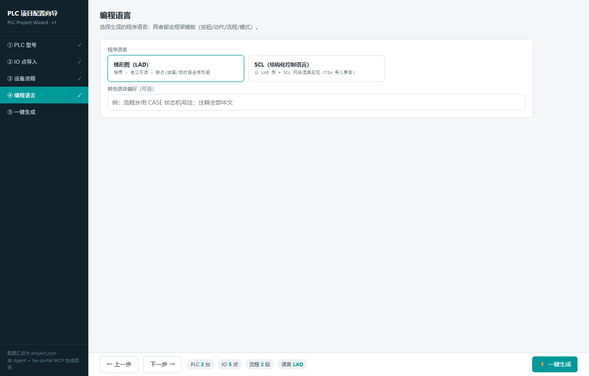
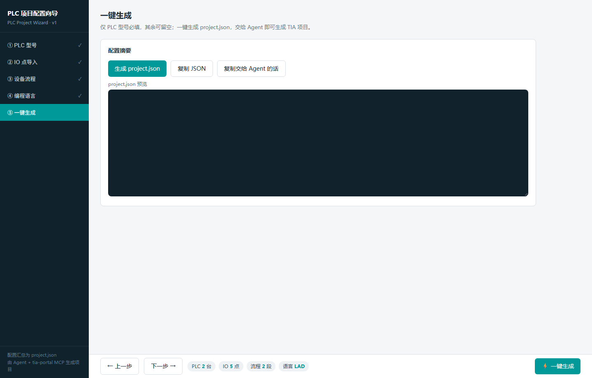

# tiaxmz-tgdwjp — TIA PLC 项目开发 Skill

**v1.1**

通用 Agent Skill（SKILL.md 规范），在 MiMo Desktop / MiMoCode 开箱即用，也适用于 Claude Code 等支持同类 skill 规范的 Agent。按固定六步交付西门子 TIA Portal（博图）S7 程序，从建项目到编译交付全流程；附带一个 **CubeMX 式配置向导**（`wizard/`），图形化收集配置、一键生成 `project.json` 交给 Agent 执行。

## 安装（两步）

1. **下载**：本页右上 Code → Download ZIP（或 `git clone https://github.com/Wangjiapeng0630/tiaxmz-tgdwjp.git`）
2. **安装 skill**：把压缩包里的 `tiaxmz-tgdwjp/` 目录拷到 skill 根目录：

```text
MiMo Desktop / MiMoCode：
  全局：  ~/.config/mimocode/skills/tiaxmz-tgdwjp/
  项目：  <project>/.mimocode/skills/tiaxmz-tgdwjp/

其他 Agent（如 Claude Code）：
  复制到其各自的 skills 目录即可，SKILL.md 为通用规范
```

装好后 MiMo Desktop「设置 → 插件」页可见「TIA PLC 项目开发」，新开会话即可触发。

## 使用流程（每步做什么）

> 两条路可单用也可组合：只用向导收集配置，或直接对话让 Agent 写程序；完整链路是「向导出配置 → Agent 生成项目」。

### 第 1 步：打开配置向导

**双击 `wizard/index.html` 即可**（纯静态页面，无需起服务）。左侧为五段导航，底部操作条实时汇总（PLC 台数 / IO 点数 / 流程段数 / 语言）。

### 第 2 步：① PLC 型号



填项目名称、选 TIA 版本（V21/V20/V18，默认 V21）。每台 PLC：设备名、系列（S7-1200 / S7-1200 G2 / S7-1500）、型号与**订货号都是下拉选择**（双向联动、固件按系列自动切换），多台用「+ 添加 PLC」。目录外的特殊订货号选「自定义 / 其他订货号…」手填。

### 第 3 步：② IO 点导入



两种方式（可混用）：
- **方式一：自己添加**——「+ 加一行」逐行填地址/中文变量名/符号/注释，每行可选所属 PLC；
- **方式二：导入文档 / 图片**——选 Excel/Word/PDF/图片，附件以 base64 随 `project.json` 走，生成时由 AI 分析提取 IO 点。

### 第 4 步：③ 设备流程



- **模式与触发**：按 PLC 填模式名与触发方式（如「复位信号=1 时按启动按钮」），「+ 加模式」可任意增删；
- **动作序列**：不写表格，直接用**文字描述**动作顺序、完成判据、延时（AI 生成前会提纯成流程步并回你确认）；
- **添加块（程序块库）**：框架四块（按钮/动作/流程/模式）+ 全局/沿 DB 固定包含；可选库块——报警、通讯、轴控、计时、产量、HMI（勾选即加入项目）。

### 第 5 步：④ 编程语言



选 **梯形图（LAD，推荐）** 或 **SCL**（以 LAD 壳 + SCL 网络混编实现，TIA 导入兼容）。

### 第 6 步：⑤ 一键生成



**仅 PLC 型号必填**，其余可留空——没填的部分会在摘要里提示「将留空补问」。点「生成 project.json」下载配置文件（JSON 预览可复制）。

### 第 7 步：交给 Agent 生成项目

把 `project.json` 放进工作目录，对 Agent 说「**按配置生成项目**」。Agent 按六步任务执行（右侧任务栏逐项打勾）：

1. 环境接入：建项目 + 按配置添加每台 PLC
2. 生成中文命名 IO 变量表（附件里的文档/图片此时由 AI 分析）
3. **控制要求提纯 → 你确认「行」** 后才动代码
4. 按标准框架搭按钮/动作/流程/模式 + 全局/沿 DB
5. 梯形图（或 SCL）编写并导入
6. 编译 0 错 → 逐段逻辑核对 → 保存 → 释放项目供 TIA 界面查看

> 流程留空时：只生成一个**空 Main 程序**，IO 变量表照常生成。

## 对话式使用（不用向导）

直接对 Agent 说「写 TIA 程序」「做 PLC 项目」「博图编程」，或发来 IO 表/控制要求/工艺描述。Agent 会先给一张**开工材料清单**（设备信息、IO、控制要求、信号约定、延时参数）请你一次交全，然后走同样的六步流程。工作流必经「控制要求提纯 → 用户确认」关卡，全程以任务清单（右侧任务栏）跟踪进度。

## 目录结构

```text
tiaxmz-tgdwjp/                        # skill 本体（安装这层目录）
├── SKILL.md                          # 六步工作流、规则、示例、避坑速查
├── references/
│   ├── lad-s7dcl-syntax.md           # 梯形图 S7DCL 导入语法全套
│   ├── framework-template.md         # 程序框架模板（按钮/动作/流程/模式）
│   └── wizard-config.md              # 向导 project.json 配置格式
└── locales/                          # 插件页显示名（zh-CN / en-US）
wizard/
├── index.html                        # CubeMX 式配置向导（双击打开）
docs/images/                          # 界面截图
```

## 依赖

- 支持 Agent Skill 规范的客户端：MiMo Desktop / MiMoCode / Claude Code 等（skill 载体）
- `tia-portal` MCP 服务器（连接 TIA Portal Openness，需 TIA V20/V21 与 Openness 用户组权限）

## License

见 [LICENSE](./LICENSE)。
